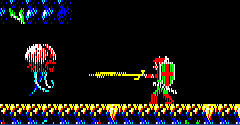

# Zeliard Reverse Engineering

Unofficial C++23 and SDL3 port of **Zeliard**, originally released for DOS in 1989.

This project aims to faithfully reconstruct the original game behavior, rendering, timing, data formats and gameplay systems. Original assembly sources and game data are used as primary references.

The goal is preservation and technical understanding first, not modernization for its own sake.

> [!IMPORTANT]
> This project is incomplete and is not an official Sierra release.

## Current Status

The current build focuses on the Muralla town sequence.

Implemented systems currently include:

- SDL3 application and rendering setup
- Native 320x200 logical resolution
- Desktop and fullscreen rendering
- Original `.GRP` decompression
- Original town pattern decoding
- Original `.MDT` town map parsing
- Town background and tile rendering
- Player rendering and animation
- Town NPC rendering and behavior
- Horizontal movement and scrolling
- Town-to-town transitions
- Dialog rendering and interaction
- HUD, life, gold, almas and equipment display
- Original MCGA palette support
- Fixed-timestep town updates
- WebAssembly browser build
- Initial music reconstruction as editable Furnace projects

The game currently starts in the castle town map and can transition through the implemented Muralla town sequence.

## Web Preview

An experimental WebAssembly preview is available at:

https://thedragonheir.github.io/Zeliard/

The browser version is a development preview. It does not represent a complete release.

## Screenshots

The current build renders the original game data at a logical resolution of 320x200.

Desktop presentation currently uses a 960x600 base window and starts in fullscreen mode on native desktop builds.

## Controls

| Key | Action |
|---|---|
| Left Arrow | Move left |
| Right Arrow | Move right |
| Space | Interact or continue dialog |
| F11 | Toggle fullscreen |
| Escape | Exit the game |

Controls may change as additional gameplay systems are implemented.

## Project Goals

- Recreate the original DOS behavior as accurately as possible
- Decode and use the original Zeliard data formats
- Treat the original assembly code as the primary behavioral reference
- Preserve integer-based gameplay and original timing behavior
- Use the original graphics and palette data
- Reconstruct the original music in editable formats
- Keep the implementation small, readable and project-owned
- Avoid large engines and unnecessary dependencies
- Document reverse-engineering findings
- Prefer accuracy before visual or mechanical polish

## Technical Overview

| Component | Implementation |
|---|---|
| Language | C++23 |
| Platform layer | SDL3 |
| Logical resolution | 320x200 |
| Desktop base window | 960x600 |
| Rendering | SDL3 renderer with logical presentation |
| Timing | Fixed town update interval |
| Data sources | Original GRP, MDT, SAR and binary files |
| Desktop platforms | Windows |
| Browser platform | WebAssembly through Emscripten |
| Build system | CMake with presets |

The desktop build enables vertical synchronization and requests the dedicated GPU on supported hybrid NVIDIA and AMD laptops.

Town updates use a fixed timestep with a limited number of catch-up updates per rendered frame. Gameplay remains integer-based, while presentation behavior is handled separately.

## Original Game Data

The runtime expects legally obtained original Zeliard data files under:

```text
game/0/
```

Examples include:

```text
cmap.mdt
mrmp.mdt
cpat.grp
mpat.grp
dpat.grp
mman.grp
cman.grp
tman.grp
```

The project reads and decodes these files directly instead of converting the game into modern image or map formats.

Original game data and copyrighted assets should not be redistributed unless legally permitted.

## Building

### Requirements

- A C++23-capable compiler
- CMake
- SDL3
- A supported Windows development environment

Run all commands from the repository root.

### Debug Build

```powershell
cmake --preset x64-debug
cmake --build --preset x64-debug
```

Run the game with:

```powershell
out\build\x64-debug\Zeliard.exe
```

### Release Build

```powershell
cmake --preset x64-release
cmake --build --preset x64-release
```

Generated build output is written to `out/` and should not be edited manually.

## Project Layout

```text
AGENTS.md   Repository workflow and contribution guidelines
asm/        Original assembly sources and reverse-engineering references
assets/     Project assets, music sources and reference data
docs/       Technical documentation and fidelity research
game/       Original game data used by the runtime and analysis tools
src/        C++23 source code
tools/      Python tools for inspecting and extracting game data
web/        Browser shell and WebAssembly support files
out/        Generated CMake build output
```

### Source Layout

```text
src/
├── zeliard.cpp
├── zeliard.hpp
├── grp/
├── hud/
├── mcga/
├── mdt/
└── town/
```

The implementation is divided by original game responsibility rather than by a generic engine architecture.

For example:

- `grp/` handles original graphics decompression and decoding
- `mdt/` handles town map and descriptor data
- `mcga/` handles palette and low-level drawing behavior
- `town/` handles town simulation, actors, transitions and rendering
- `hud/` handles persistent screen information and equipment panels

## Documentation

Technical research and implementation notes are stored under `docs/`.

Important documents include:

- Town engine and graphics analysis
- Town fidelity audit
- Runtime architecture and build notes
- Global memory map and data structures
- WebAssembly build documentation
- Original format and rendering research

Documentation should distinguish confirmed assembly-backed behavior from assumptions and experimental findings.

## Music

Original Zeliard music is being analyzed and reconstructed as editable Furnace Tracker projects.

Music source material is stored under:

```text
assets/music/src/
```

The current music workflow includes:

1. Extracting original VGM register activity
2. Analyzing YM3812 and AdLib behavior
3. Reconstructing instruments and sequencing
4. Saving editable `.fur` project files
5. Comparing reconstructed playback against the original soundtrack

Runtime music playback is not implemented yet.

## Roadmap

### Town Systems

- [x] SDL3 startup and rendering
- [x] Original town data loading
- [x] GRP pattern decoding
- [x] Town map rendering
- [x] Player movement
- [x] Town scrolling
- [x] NPC rendering and behavior
- [x] Town transitions
- [x] Dialog rendering
- [x] HUD rendering
- [ ] Shops
- [ ] Building interiors
- [ ] Remaining town interactions

### Cavern Systems

- [ ] Cavern map loading
- [ ] Cavern tile rendering
- [ ] Player platform movement
- [ ] Jumping and climbing
- [ ] Enemies
- [ ] Combat
- [ ] Doors and room transitions
- [ ] Items and treasure
- [ ] Boss encounters

### Shared Systems

- [ ] Save and load
- [ ] Runtime music playback
- [ ] Sound effects
- [ ] Inventory management
- [ ] Full progression state
- [ ] Complete game flow

## Development Principles

The project follows several strict principles:

- Understand original behavior before implementing it
- Use assembly evidence whenever available
- Keep gameplay logic independent from presentation smoothing
- Avoid speculative architecture
- Avoid unnecessary engine abstractions
- Keep changes focused and reviewable
- Preserve original timing, coordinates and data relationships
- Document uncertain findings honestly
- Do not modernize behavior without a clear reason

## Contributing

Read [`AGENTS.md`](AGENTS.md) before making changes.

Contributions should:

- Remain narrowly scoped
- Follow the existing C++ style
- Use four-space indentation
- Keep braces on separate lines
- Avoid unrelated refactoring
- Include validation instructions
- Avoid committing generated build output
- Preserve original assets and reference material
- Clearly separate confirmed behavior from assumptions

Changes should be validated by rebuilding and launching the application.

## Legal Notice

Zeliard and all original game content belong to their respective copyright holders.

This repository is an unofficial preservation, research and reimplementation project. It is not affiliated with, endorsed by or sponsored by Sierra, Game Arts or any current rights holder.

No ownership of the original game, characters, artwork, music or trademarks is claimed.
